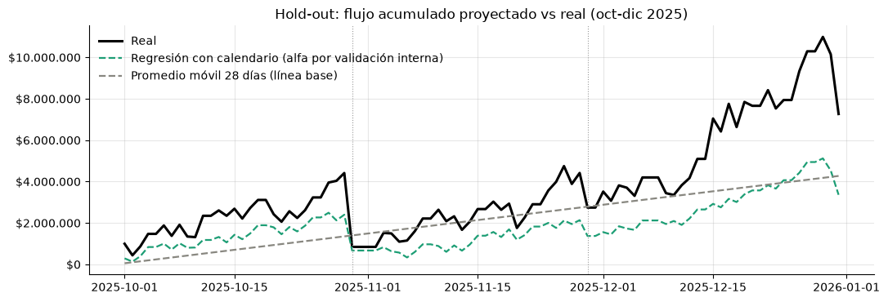

# Evaluación del modelo elegido: MAE y RMSE en un conjunto de validación

Evaluación final del modelo que se eligió en [MODELO.md](MODELO.md): **regresión con calendario
con alfa por validación interna**. Se mide con MAE y RMSE sobre un conjunto de validación separado
del de entrenamiento (hold-out), y se interpreta qué tan confiable es la proyección.

## Resumen para el informe final

Se entrenó el modelo con los datos de enero 2024 a septiembre 2025 y se validó con el último
trimestre de 2025 (92 días) que no vio al ajustarse. Resultados en el dataset principal, en pesos:

| | MAE | RMSE |
|---|---|---|
| Flujo neto de cada día | $334.217 | $498.048 |
| Saldo de caja acumulado, primeros 30 días | $931.697 | $1.021.992 |
| Saldo de caja acumulado, primeros 60 días | $1.063.352 | $1.186.370 |
| Saldo de caja acumulado, 92 días | $1.825.415 | $2.298.753 |

Con ingresos de unos $16 millones al mes, **la proyección a 30 días es confiable para decidir si
alcanza la caja**: se desvía en promedio menos de $1 millón (≈ 6 % de lo que entra en el mes) y le
gana con claridad a la línea base (MAE $1.583.776). A 60 días sirve como tendencia, y a 90 días
solo como orientación: no anticipa bien el alza de diciembre. **El monto de cada día por separado
no es confiable** (el error medio es 61 % del movimiento típico de un día). En este período el
error fue **conservador**: el modelo mostró menos caja de la que hubo, no más. En los meses más
difíciles del backtest el error a 30 días llegó a $2,3 millones (percentil 90), así que la
proyección debe mostrarse con un margen y no como una cifra exacta.



## Cómo se evaluó

- **Corte temporal, no aleatorio.** Entrenamiento: 01-01-2024 a 30-09-2025 (639 días).
  Validación: 01-10-2025 a 31-12-2025 (92 días). En una serie de tiempo, sortear días al azar
  dejaría días del futuro en el entrenamiento y el modelo "conocería" lo que tiene que proyectar.
- **El modelo no ve la validación en ningún momento.** Se le pasa solo el entrenamiento; también
  el alfa se elige dentro del entrenamiento (eligió **30** en el principal y **10** en la réplica).
  Después proyecta los 92 días de una vez, como si fuera el 30 de septiembre.
- **Dos datasets.** El principal (semilla 42) es el que se informa. El de confirmación (semilla
  2026, la misma pyme simulada) repite la evaluación para ver si el resultado se sostiene.
- **Línea base como referencia** (promedio móvil de 28 días), evaluada exactamente igual.
- El corte, las métricas y las ventanas se fijaron antes de correr la evaluación
  (`cashpyme_modelos/evaluacion.py`: `separar_holdout`, `errores_holdout`).

## Las métricas

- **MAE** (error absoluto medio): en promedio, por cuántos pesos se equivoca. Se lee directo:
  "se equivoca en $X".
- **RMSE** (raíz del error cuadrático medio): castiga más los errores grandes. Si es mucho mayor
  que el MAE, el error no es parejo: hay días o semanas donde se equivoca mucho.

Se miden sobre dos cosas distintas:

1. **Cada día**: ingresos, egresos y flujo neto (ingresos − egresos) de cada día.
2. **El saldo acumulado**: la caja proyectada día a día (suma del flujo neto desde el inicio de la
   validación), que es lo que el usuario ve en la proyección. Se calcula sobre los primeros 30, 60
   y 92 días. Se informa también el error al cierre (proyectado − real el último día): negativo
   significa que el modelo mostró **menos** caja de la real.

## Resultados

### Dataset principal (semilla 42)

Ingreso diario promedio en la validación: $592.740 (unos $16 millones al mes).

**Cada día**

| Modelo | Métrica | Ingresos | Egresos | Flujo neto |
|---|---|---|---|---|
| **Regresión con alfa interno** | MAE | **$195.003** | **$301.510** | **$334.217** |
| | RMSE | **$313.902** | **$431.860** | **$498.048** |
| Línea base (promedio móvil 28 días) | MAE | $323.528 | $604.559 | $544.496 |
| | RMSE | $428.485 | $770.242 | $780.960 |

**Saldo acumulado**

| Modelo | Métrica | 30 días | 60 días | 92 días |
|---|---|---|---|---|
| **Regresión con alfa interno** | MAE | **$931.697** | **$1.063.352** | $1.825.415 |
| | RMSE | **$1.021.992** | **$1.186.370** | $2.298.753 |
| | Error al cierre | −$174.937 | −$1.371.059 | −$3.904.529 |
| Línea base | MAE | $1.583.776 | $1.084.759 | **$1.635.567** |
| | RMSE | $1.708.555 | $1.320.286 | **$2.259.323** |
| | Error al cierre | +$553.989 | +$45.763 | −$2.993.483 |

### Dataset de confirmación (semilla 2026)

Ingreso diario promedio en la validación: $581.766.

| Modelo | Métrica | Flujo neto (día) | Saldo 30 días | Saldo 60 días | Saldo 92 días |
|---|---|---|---|---|---|
| **Regresión con alfa interno** | MAE | **$264.845** | **$482.227** | **$1.071.711** | **$1.369.142** |
| | RMSE | **$427.067** | **$688.803** | **$1.340.387** | **$1.667.367** |
| | Error al cierre | | −$770.345 | −$1.161.747 | −$3.529.945 |
| Línea base | MAE | $577.606 | $1.230.763 | $1.132.770 | $1.545.138 |
| | RMSE | $831.500 | $1.518.746 | $1.436.259 | $2.156.413 |
| | Error al cierre | | +$156.599 | +$49.424 | −$3.866.855 |

### Margen observado en el backtest

El hold-out es un solo trimestre. Para saber cuánto puede variar el error, se usa también el
backtest de [MODELO.md](MODELO.md): 10 proyecciones, una por mes, todas fuera de muestra. Error del
saldo al día 30:

| Dataset | Mediana | Percentil 90 | Máximo |
|---|---|---|---|
| Principal | $1.520.685 | $2.331.895 (14,2 % de los ingresos del mes) | $2.920.083 |
| Confirmación | $773.607 | $2.058.977 (15,2 %) | $3.507.859 |

## Interpretación: ¿qué tan confiable es la proyección?

**A 30 días: confiable para decidir, con margen.** En el hold-out, el saldo proyectado se desvía en
promedio $0,5 a $0,9 millones de la caja real (3 a 6 % de lo que entra en el mes) y cierra el día
30 con menos de $0,8 millones de diferencia. Es menos de la mitad del error de la línea base
($1,2 a $1,6 millones). En el principal el RMSE es apenas 1,1 veces el MAE: el error del saldo es
parejo durante el mes (en la réplica, 1,4 veces). Pero el backtest muestra que hay meses peores: en 1 de cada 10 meses el error al día 30
supera los $2,1 a $2,3 millones. Por eso la proyección debe mostrarse con un margen (por ejemplo,
±$2,3 millones a 30 días) y la alerta de caja negativa debe leerse como "riesgo", no como certeza.

**A 60 días: útil como tendencia.** El error medio sube a ~$1,1 millones. Sigue siendo mejor que la
línea base, pero por poco en el MAE ($1.063.352 contra $1.084.759 en el principal); la ventaja se ve
más en el RMSE. Lo que aporta frente a la línea base es la **forma**: anticipa las caídas de fin de
mes (sueldos, proveedores), que el promedio no ve.

**A 90 días: solo orientativa.** El error medio llega a $1,4 a $1,8 millones y al cierre a −$3,5 a
−$3,9 millones. La causa es diciembre: el modelo aprendió ese mes de un solo año de historia, y la
penalización (alfa) lo acerca al promedio, así que subestima el alza de fin de año. En el dataset
principal, a 92 días, la línea base incluso lo supera en MAE. Con más años de datos este efecto
debería bajar.

**Día a día: no confiable.** El error medio del flujo neto de un día es $334.217, 61 % del
movimiento típico de un día ($544.496). El RMSE es 1,5 veces el MAE: el error se concentra en días
puntuales con movimientos grandes, como pagos de sueldos o a proveedores. Los errores
diarios se compensan al acumular, por eso el saldo sale mucho mejor que cada día. En la pantalla
conviene mostrar el saldo acumulado o totales semanales, no el monto exacto de un día.

**El sesgo es conservador.** En los dos datasets y en todos los horizontes, el error al cierre fue
negativo: el modelo mostró **menos** caja de la que hubo. Para una alerta de iliquidez es el error
menos dañino: puede avisar de más, pero no dio tranquilidad falsa. La línea base hizo lo contrario
a 30 días (+$0,55 millones). Este sesgo se observó en un trimestre; no está garantizado para todos.

## Limitaciones

- **Datos sintéticos.** Todo se midió sobre una pyme simulada. Con datos reales (clientes que
  pagan tarde, gastos imprevistos, cambios de precio) el error será distinto, probablemente mayor.
- **Un solo trimestre de validación**, y es el de mayor estacionalidad (diciembre). Por eso se
  acompaña con el margen del backtest, que cubre 10 meses distintos.
- **La validación no se usó para ajustar el modelo, pero sí formó parte de la comparación** con que
  se eligió (el backtest de MODELO.md incluye una proyección desde el 1 de octubre de 2025). Que el
  resultado se repita en el dataset de confirmación reduce, pero no elimina, esa duda.
- **El modelo proyecta solo con el calendario.** No sabe de facturas registradas ni de pagos
  pactados: eso lo aporta la proyección por documentos del backend, con la que se va a combinar.

## Reproducir

```bash
cd analitica
.venv\Scripts\pip install -r requirements-modelos.txt
.venv\Scripts\python comparar_modelos.py    # elige el modelo
.venv\Scripts\python evaluar_holdout.py     # MAE y RMSE en el hold-out
```

Escribe [`resultados/evaluacion_holdout.json`](resultados/evaluacion_holdout.json) (todas las
métricas) y [`resultados/holdout_diario.csv`](resultados/holdout_diario.csv) (real contra
proyectado, día por día). El gráfico sale del notebook
[`02_modelado_y_evaluacion.ipynb`](notebooks/02_modelado_y_evaluacion.ipynb), sección
"Evaluación final en hold-out". Con los mismos datasets da los mismos números.
